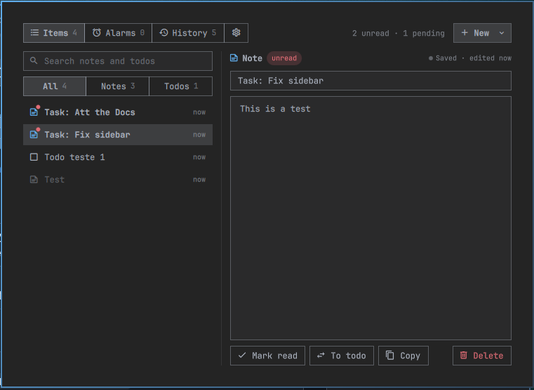
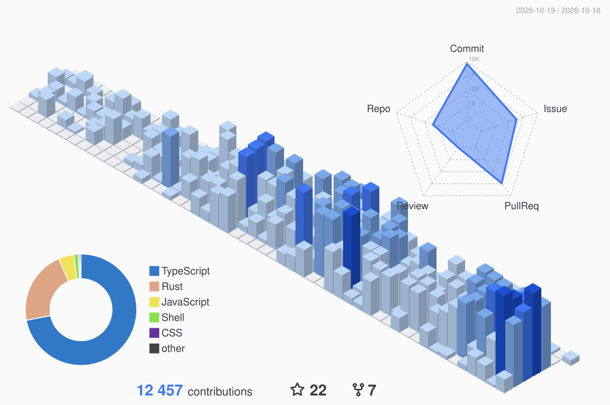

<!--
============================================================
  othavi0 — profile README
  Hero rendered at www.noctuacore.com/api/hero (voxel wordmark, steel blue).
  3D contributions generated by profile-3d.yml.
  See NOTES at the bottom.
============================================================
-->

  

  <a href="https://www.noctuacore.com">noctuacore.com</a> ·
  <a href="https://x.com/noctuacore">x.com/noctuacore</a> ·
  <a href="https://www.linkedin.com/in/othavioquiliao">linkedin</a>

### /* open source */

<table>
<tr><td><code>01</code></td><td><b><a href="https://github.com/othavi0/omarchy-agent-bar">omarchy-agent-bar</a></b></td><td>author</td><td>AI quota in your Omarchy bar. Claude, Codex, Amp, Grok and Antigravity chips with usage windows and reset countdowns.</td></tr>
<tr><td><code>02</code></td><td><b><a href="https://github.com/othavi0/omanotes">omanotes</a></b></td><td>author</td><td>Notes, todos and alarms in one panel on the Omarchy bar, with a history tab. Stored in a local SQLite file.</td></tr>
<tr><td><code>03</code></td><td><b><a href="https://github.com/othavi0/omarchy-noctua-theme">omarchy-noctua-theme</a></b></td><td>author</td><td>One Dark Pro syntax on a neutral #242424 base. Terminal, shell, editor and app themes for Omarchy.</td></tr>
<tr><td><code>04</code></td><td><b><a href="https://github.com/othavi0/noctua-skills">noctua-skills</a></b></td><td>author</td><td>Four Claude Code skills: dev-up, mobile-up, claude-md-prune and humanize-pt-br. <code>npx skills@latest add othavi0/noctua-skills</code></td></tr>
</table>

### /* showcase */

<table width="100%">
<tr>
<td width="33%"></td>
<td width="33%"></td>
<td width="33%"></td>
</tr>
<tr>
<td align="center"><a href="https://github.com/othavi0/omarchy-noctua-theme">omarchy-noctua-theme</a></td>
<td align="center"><a href="https://github.com/othavi0/omarchy-agent-bar">omarchy-agent-bar</a></td>
<td align="center"><a href="https://github.com/othavi0/omanotes">omanotes</a></td>
</tr>
</table>

### /* contributions */

<table>
<tr><td><code>01</code></td><td><b><a href="https://github.com/herdrdev/herdr">herdr</a></b></td><td><a href="https://github.com/herdrdev/herdr/pull/25">#25</a></td><td>The runtime your coding agents live on. Terminal workspace manager for AI agents, 45k stars.</td></tr>
<tr><td><code>02</code></td><td><b><a href="https://github.com/builderz-labs/mission-control">mission-control</a></b></td><td><a href="https://github.com/builderz-labs/mission-control/pull/102">#102</a></td><td>Self-hosted control plane for AI agents. Dispatch tasks, review runs, track spend.</td></tr>
<tr><td><code>03</code></td><td><b><a href="https://github.com/larissa04alves/omadoro">omadoro</a></b></td><td><a href="https://github.com/larissa04alves/omadoro/pulls?q=is%3Apr+author%3Aothavi0">5 PRs</a></td><td>Pomodoro timer plugin for omarchy-shell. Ported it to the plugin API and wrote the docs.</td></tr>
<tr><td><code>04</code></td><td><b><a href="https://github.com/SikandarJODD/svelte-animations">svelte-animations</a></b></td><td><a href="https://github.com/SikandarJODD/svelte-animations/pull/9">#9</a> <a href="https://github.com/SikandarJODD/svelte-animations/pull/34">#34</a></td><td>Svelte Magic UI and Aceternity components built with Tailwind.</td></tr>
</table>

  

<!--
NOTES — pendências (não renderiza)
1) Hero vive em noctuacore (apps/web/src/app/api/hero). Deploy do site publica em www.noctuacore.com/api/hero.
   Migrado de othavio-site em 2026-08-22: o domínio othavio.com saiu do ar e o  quebrou.
2) noctua-skills: repo público com 4 skills (dev-up, mobile-up, claude-md-prune, humanize-pt-br), instalável via npx skills@latest add othavi0/noctua-skills.
3) O 3D (profile-one-dark.svg) é regenerado diariamente pela Action profile-3d.yml.
4) Showcase usa raw.githubusercontent dos próprios repos (omarchy-noctua-theme main/preview.png, omarchy-agent-bar master/preview.png) — trocar o path se o preview mudar de lugar.
   O print do omanotes fica neste repo (assets/omanotes.png), escolhido pelo user em 2026-10-21 no lugar do preview.png do repo omanotes.
5) Nomes canônicos em 2026-09-03: agent-bar virou omarchy-agent-bar, skills virou noctua-skills, herdr mudou de ogulcancelik para herdrdev. Os links antigos redirecionam, mas o README usa os atuais.
6) Contribuições: herdr #25, mission-control #102, omadoro (5 PRs), svelte-animations #9 e #34, todos com merge.
   Fora por decisão do user em 2026-10-21: workspace-lens #2 e omatodolist #2 e #4. rtk #1768 saiu porque fechou sem merge.
-->
